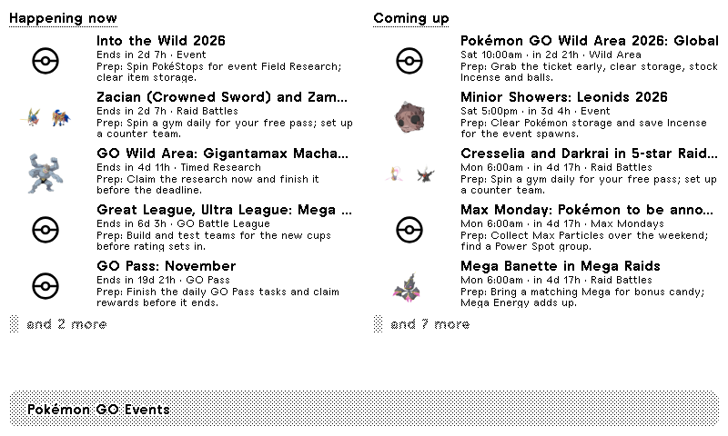
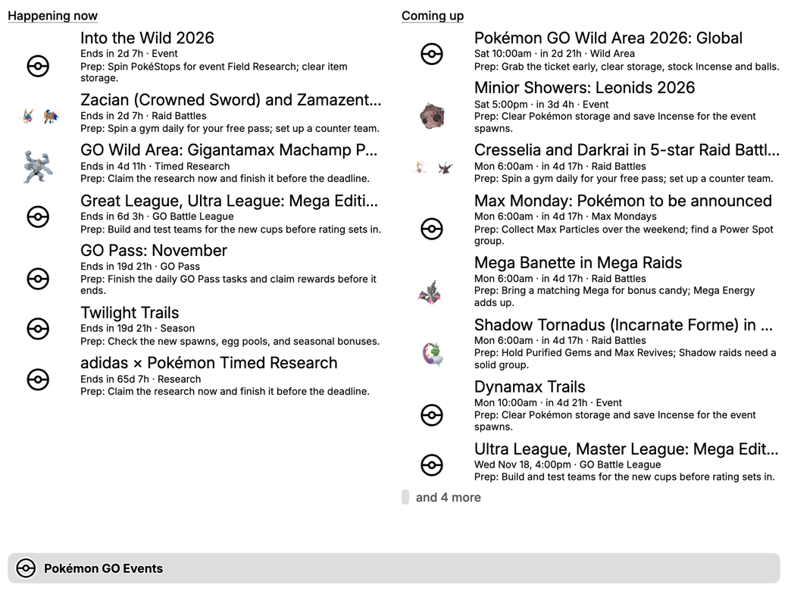

# Pokémon GO Events for TRMNL

A [TRMNL](https://trmnl.com) e-ink display plugin that shows the Pokémon GO events happening now and coming up. Each event comes with a short **prep tip** and a picture of the Pokémon it features.



<details>
<summary>Full view on a TRMNL X (landscape)</summary>



</details>

*Previews are rendered locally with TRMNL's framework. On a real device TRMNL converts the Pokémon artwork to black and white or grayscale for e-ink.*

## Features

- **Happening now:** live events, ending soonest first, with a countdown ("Ends in 2d 7h").
- **Coming up:** events in the next 14 days (adjustable), soonest first, with day and time.
- **Prep tips** for every event, for example:

  | Event | Tip |
  |---|---|
  | Spotlight Hour (2× Stardust) | Pop a Star Piece at the start; carry plenty of Poké Balls. |
  | Mega raids | Bring a matching Mega for bonus candy; Mega Energy adds up. |
  | Shadow raids | Hold Purified Gems and Max Revives; Shadow raids need a solid group. |
  | Max Monday | Collect Max Particles over the weekend; find a Power Spot group. |
  | Community Day | Clear storage, stock balls, Lucky Egg + Star Piece. Save candy to evolve before it ends. |

- **Featured Pokémon** pictures: raid bosses, Spotlight and Community Day Pokémon, and any Pokémon named in the event headline. Other events get a Poké Ball.
- **Every size and screen:** full, half horizontal, half vertical and quadrant layouts, on TRMNL OG and TRMNL X, landscape or portrait. Each list fills its space and ends with "and N more".
- **No setup:** no account or API key needed.

## Install

### NOW LIVE IN THE OFFICIAL TRMNL PLUGINS!
[Click here to add the plugin](https://trmnl.com/recipes/pokemon-go-events-517332?via=search)

**Option A: import the zip.** Build it from `src/` (the zip isn't committed):

```bash
(cd src && zip ../pokemon-go-events.zip settings.yml *.liquid)
```

Then in TRMNL go to Plugins → Private Plugin → **Import**, and upload `pokemon-go-events.zip`.

**Option B: set it up by hand.** Create a Private Plugin, then:
- Strategy: **Polling**, URL: `https://raw.githubusercontent.com/bigfoott/ScrapedDuck/data/events.min.json`, refresh every 60 min.
- Paste `src/shared.liquid` into the **Shared** markup tab.
- Paste each `src/<layout>.liquid` into the Full / Half horizontal / Half vertical / Quadrant tabs.
- Copy the custom fields from `src/settings.yml` into the form builder.

Event times use the time zone in your TRMNL account settings, so make sure it's correct.

## Settings

| Setting | What it does |
|---|---|
| Look-ahead (days) | How far ahead to list upcoming events (1–60, default 14). |
| Hide event types | Leave out noisy types, such as GO Battle League or raid rotations. |

## Project layout

```
src/
  settings.yml            Plugin settings: data feed, refresh rate, form fields
  shared.liquid           All the logic, plus the event_item and title_bar templates
  full.liquid             Full-screen layout
  half_horizontal.liquid  Half-screen layouts for mashups
  half_vertical.liquid
  quadrant.liquid         Quarter-screen layout
docs/                     README screenshots
.trmnlp.yml               Local preview config for trmnlp
```

## How it works

- **Data:** the plugin polls the free [ScrapedDuck](https://github.com/bigfoott/ScrapedDuck) feed, which mirrors [LeekDuck's event calendar](https://leekduck.com/events/).
- **Logic:** `src/shared.liquid` sorts events into *now* and *upcoming*, converts times, picks a prep tip, and finds the featured Pokémon. Every layout renders its two templates: `event_item` (one event row) and `title_bar`.
- **Times:** event times without a trailing `Z` are local time. Times with `Z` (global events) are UTC. Both are shown in your TRMNL account's time zone (`trmnl.user.utc_offset`).
- **Pokémon images:**
  - Raid bosses, Spotlight Hour and Community Day use LeekDuck's icons from the feed.
  - Other events: the plugin looks for Pokémon names in the headline and uses [PokéAPI](https://pokeapi.co/) official artwork.
- **Prep tips** depend on the event type, and for some types on event details too, such as the Spotlight Hour bonus or Shadow vs. Mega raids. To change the advice, edit the `case` block in `shared.liquid`.

## Development

Preview locally with [trmnlp](https://github.com/usetrmnl/trmnlp):

```bash
trmnlp serve
```

Run it from the repo root; it reads `.trmnlp.yml`.

Layout notes:
- **Framework utilities only:** no custom CSS or JavaScript. Layout files start at `.layout` and the title bar; TRMNL adds the `view` wrapper.
- **Overflow:** the framework's overflow engine decides how many events show (`data-overflow="true"` with `data-overflow-counter`). Line limits use `data-clamp`.
- **Portrait:** the full view shows two columns in landscape and stacks them in portrait (`portrait:flex--col`). Titles grow on large screens (`lg:title--base`).
- **Tested:** in a local preview against framework 3.4 on TRMNL OG (1-bit), TRMNL X landscape and TRMNL X portrait, nothing is cut off and each screen is 87–97% filled.
- **Two framework quirks shaped the markup:**
  - **Rows are marked `flex`.** Line limits measure against the nearest `flex` or `grid` ancestor. Marking each row `item flex` makes them measure the text area, not the whole row with its image.
  - **The generic overflow container is used, not `.columns`.** On the scaled TRMNL X preview, the `.columns` engine mixed scaled and unscaled pixels and let lists overflow. Spacing between rows is padding (`pb--2`), not gap, so it's counted in each row's height.

## Credits

- Event data: [LeekDuck](https://leekduck.com/events/), via [ScrapedDuck](https://github.com/bigfoott/ScrapedDuck)
- Pokémon artwork: [PokéAPI](https://pokeapi.co/) and LeekDuck
- Built on the [TRMNL Framework](https://trmnl.com/framework)

Questions or suggestions: jonathan@jonathanschmid.com

*Unofficial fan project. Not affiliated with Niantic, Nintendo, The Pokémon Company, or LeekDuck. Pokémon and Pokémon GO are trademarks of their respective owners.*
